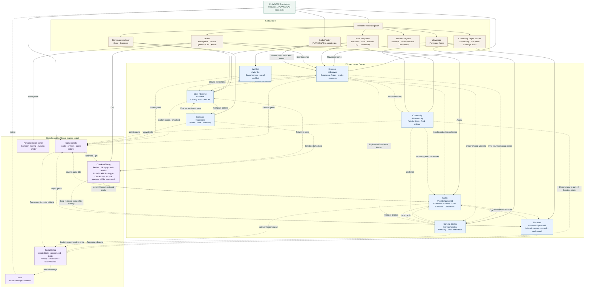
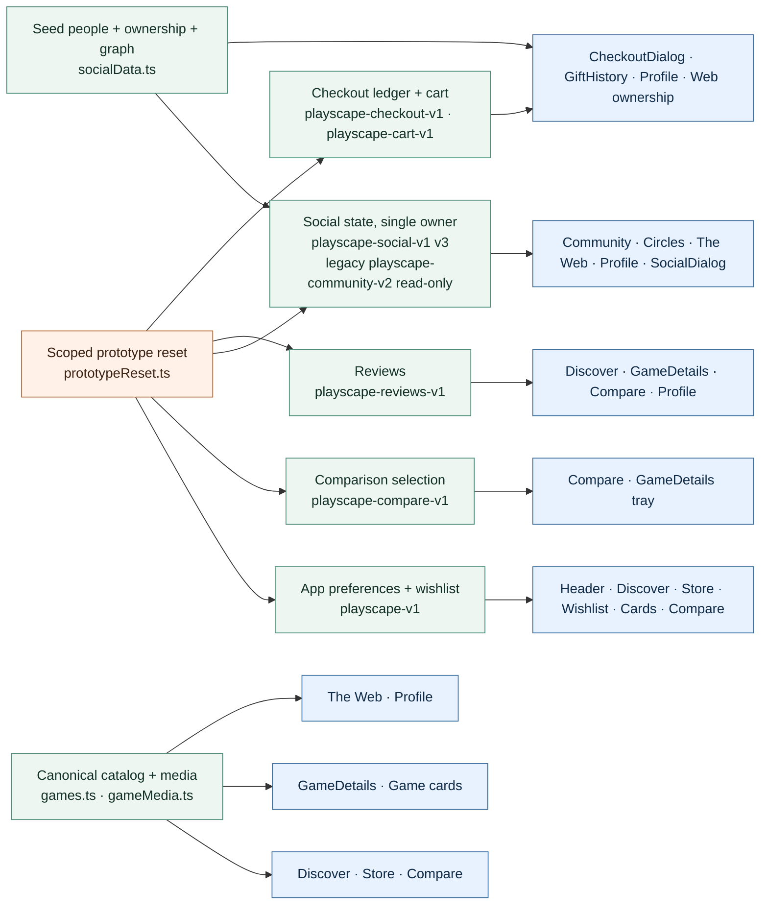

# PLAYSCAPE information architecture

This visual reflects the active prototype only: `src/main.tsx` mounts `src/PLAYSCAPE-cleaner.tsx`, which owns hash routing, view state, overlays, and feature composition.

Solid lines are structural shell/navigation links. Dashed lines are cross-links, actions, or derived state flows.

## Navigation and view hierarchy

## Route map

| Hash | View | Navigation home |
| --- | --- | --- |
| `#/discover` | Discover | Brand, main nav, footer |
| `#/browse` | Browse, displayed as `Store` | Main nav, Store pages subnav |
| `#/wishlist` | Wishlist | Main nav |
| `#/compare` | Compare | Store pages subnav |
| `#/community` | Community | Main nav, Community pages subnav |
| `#/the-web/:personId` | The Web | Community pages subnav; `webFocus` on person links |
| `#/circles/:circleId` | Gaming Circles | Community pages subnav |
| `#/profile/:personId` | Profile | Avatar and profile cross-links; not a primary nav item |

Overlays render over the current route and do not write a new hash. `#/profile/:id`, `#/circles/:id`, and `#/the-web/:id` use the suffix for the selected person or circle.

## State and data domains

## Prototype boundaries

- `Store` is a display label for the `Browse` view; there is no separate `Store` route.
- The checkout ledger is the single source of truth for prototype purchases and gifts. Seeded ownership plus ledger-derived per-person ownership feed profiles and The Web.
- Gifts are accepted at creation: the recipient gains local prototype ownership, the sender does not, and no delivery or notification occurs.
- Fake payment inputs are not transmitted, persisted, or stored. Checkout always shows `PLAYSCAPE Prototype Checkout — No real payment will be processed.`
- `PLAYSCAPE is a prototype.` remains in the global footer on every route.
- Reset lives in Profile → Gifts & Orders with explicit `purchases` and `all` scopes and a confirmation step.
